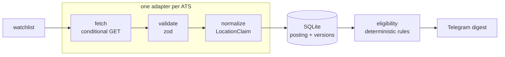

# gatecheck

gatecheck watches the job boards of the companies you care about, straight from their ATS,
and catches new postings the day they're published — no aggregator delay, no paywall.

Then it answers the question the posting itself won't: is this actually open to you?
"100% Remote" and "Work from anywhere" postings are routinely gated to a closed list of
countries — invisible in the prose, deterministic in the ATS's public JSON. Every posting is
sorted into **open**, **closed** or **unknown** for your location, and only the ones worth
reading reach you.

On a sample of 16 live boards across Ashby, Greenhouse, Lever and Recruitee (2,032 postings,
November 2026), for an applicant in Türkiye:

| verdict | postings | share |
| ------- | -------: | ----: |
| closed  |    1,923 | 94.6% |
| open    |       73 |  3.6% |
| unknown |       36 |  1.8% |

Nineteen in twenty postings never needed to be read.

## How it works



- **One adapter per ATS** — Ashby, Greenhouse, Lever, Recruitee, Workable, Teamtailor.
  Each implements `BoardSource` (`src/sources/types.ts`): `fetch`
  validates the payload at the boundary and fails loudly on a shape it doesn't know;
  `normalize` maps it to the shared model. Nothing downstream knows ATS-specific fields.
  Adding an ATS to the `Ats` union fails to compile until its adapter is registered.
- **Locations are claims, not strings.** Ashby gives a label plus a postal address,
  Greenhouse a `;`-joined label plus office groups, Lever free-text locations plus an ISO
  code for the first one, Recruitee ISO codes plus a "pick your location" question. All of
  them reduce to `LocationClaim { kind, countryCode | region, city, raw }`
  (`src/sources/claims.ts`), keeping the source text of every claim.
- **Place matching is exact, never substring.** `'turk' in s.lower()` misses "Türkiye";
  substring matching turns "New Mexico" into Mexico and "Boston, MA" into Morocco. Text is
  Unicode-folded and matched as a whole against committed tables: CLDR country names, a
  small region vocabulary, and a curated city gazetteer that leaves out names shared across
  countries (Cambridge, Hyderabad, San Jose).
- **Postings are versioned, and changes are news.** Each distinct payload is stored in
  `posting_version` with its content hash. When a posting you were already sent changes its
  places, salary band, title or verdict, the next digest says so — "removed TR (remote)",
  "EUR 60K–80K → 50K–70K", "open → closed". Reworded descriptions don't count.
- **Sources fail independently.** A broken board is recorded in `run_source` with its HTTP
  status and error, appears in the digest, and the run carries on — "why didn't I see this
  posting?" is answered by a query, not a guess.

### Eligibility rules

Deterministic, explainable, and biased against false negatives — a wrongly hidden posting
costs far more than one extra to glance at (`src/eligibility/rules.ts`):

1. Collect the posting's location claims. Explicit applicant requirements (e.g. Recruitee's
   mandatory location question) outrank labels.
2. A claim that names your country, or a region that **certainly** covers it → **open**.
3. Anything that can't be judged — a **contested** region ("Europe" for Türkiye), text that
   names no recognisable place, no location at all → **unknown**. Unknown is never
   dismissed; it lands in its own "worth a look" section.
4. Otherwise every claim excludes you → **closed**.

Every verdict carries its reason, e.g. `EMEA covers Türkiye — remote, from "Remote, EMEA"`
or `limited to SE, GB (remote)`. Seniority is never a filter.

### Company discovery

Aggregators are used to find companies, never as a source of postings. `pnpm discover`
reads Himalayas' API or WeWorkRemotely's feeds for "company X is hiring for title Y", then
looks for X's own board: first through any ATS link in the listing, then by probing slug
candidates from the company name ("Proxify AB" → `proxify-ab`, `proxify`) against each
ATS's public API.

A board is accepted only if it carries one of the aggregator's titles. That single check
proves the slug belongs to this company rather than a namesake, and that the ATS is right,
so guessing is safe. From then on the company is polled directly: the aggregator's delay and
paywall are paid once, and skipped forever after. `pnpm discover url <careers-page>` adds a
company from its careers page, including boards embedded under a custom domain.

`pnpm discover list` does the same for a whole list: a text file of careers URLs (one per
line, optionally `Name | URL`), or a directory of company profiles in the format of the
community [remote-company directory](https://github.com/remoteintech/remote-jobs)
(`src/companies/*.md`, ~880 companies). For each company it reads the careers page, or the
home page and then one careers link from it, and takes the board linked or embedded there.
The board comes from the company's own site, so no title check is needed; it is still
fetched once before it is added. Pages that point at an ATS without an adapter (Workday,
Personio, SmartRecruiters…) are tallied per system, which is how the next adapter is chosen.

LinkedIn (its terms forbid automated collection) and Jobgether (paywalled) are deliberately
not used, and pages behind bot protection are not worked around.

### Reading the text (optional)

Structure decides the verdict; some things only the prose says. `pnpm analyze` sends each
posting that passed — open or unknown — to Claude once, with the applicant's own profile
(`profile.md`, gitignored; see `profile.example.md`), and gets back a structured reading:
fit, location wording in the text ("we hire through Deel in your country of residence",
"pay reflects market standards in your region"), requirements met or missing, and a short
draft note.

The draft is kept honest mechanically. Every claim it makes about the applicant must cite a
verbatim quote from the profile, and claims the profile doesn't support — or says not to
make — are listed as left out instead of used. A grounding check then looks every quote up
in the profile; a draft with an unbacked claim is flagged in the digest and the dashboard.
The model never changes a verdict, and nothing is ever sent: drafts are files in
`data/drafts/` for a human to edit.

### Dashboard

`pnpm dashboard` serves a small Next.js app over the same SQLite file, read-only: every
posting with its verdict and reason, places, salary and fit, filterable by verdict, text,
company and country, and a page per posting with its claims, draft, change history and
stored versions.

## Polling etiquette

gatecheck reads the same public, unauthenticated endpoints that companies' own career pages
call, once a day:

- `robots.txt` honoured per host (RFC 9309), including `Crawl-delay`; a disallowed board is
  reported as a source error, not fetched;
- requests to one host spaced at least a second apart;
- an identifying `User-Agent` that points here, no personal data in it;
- conditional requests (`If-None-Match` / `If-Modified-Since`); Ashby, Greenhouse, Lever
  and Teamtailor answer `304` when nothing changed;
- bounded retries with jittered exponential backoff, honouring `Retry-After`;
- no posting data is committed or republished; test fixtures are trimmed samples.

| ATS        | Endpoint                                                                 |
| ---------- | ------------------------------------------------------------------------ |
| Ashby      | `api.ashbyhq.com/posting-api/job-board/{board}?includeCompensation=true` |
| Greenhouse | `boards-api.greenhouse.io/v1/boards/{board}/jobs?content=true`           |
| Lever      | `api.lever.co/v0/postings/{org}?mode=json`                               |
| Recruitee  | `{org}.recruitee.com/api/offers/`                                        |
| Workable   | `apply.workable.com/api/v1/widget/accounts/{account}?details=true`       |
| Teamtailor | `{careers-host}/jobs.rss`, plus the JSON-LD of fully remote job pages    |

## Using it

Requires Node 22.18+ (TypeScript runs natively via type stripping) and pnpm.

```sh
pnpm install
cp config.example.json config.json   # your country, watchlist, Telegram bot
pnpm inspect greenhouse gitlab       # preview how a board normalizes, touches nothing
pnpm poll --dry-run                  # poll, evaluate, print the digest instead of sending
pnpm poll                            # the real thing
pnpm launchd install --hour 9        # macOS: run it every morning
pnpm discover weworkremotely --keyword engineer --dry-run   # find more companies to watch
pnpm discover list companies.txt --dry-run                  # or from a list of careers pages
pnpm reprocess                       # after an adapter/resolver fix: re-read stored postings
pnpm analyze --limit 3               # optional: read top postings with Claude, write drafts
pnpm dashboard                       # browse everything at http://localhost:3000
```

`config.json` and `profile.md` are gitignored. Analysis needs Anthropic API credentials
(`ANTHROPIC_API_KEY`, or a profile from `ant auth login`) and costs one request per
posting; it is off unless `config.json` has an `analysis` section. The Telegram token and chat id can also come from
`GATECHECK_TELEGRAM_BOT_TOKEN` / `GATECHECK_TELEGRAM_CHAT_ID`. To get them, create a bot
with [@BotFather](https://t.me/BotFather), send it a message, and read your chat id from
`https://api.telegram.org/bot<token>/getUpdates`.

## Development

```sh
pnpm check         # typecheck, lint, format, tests — what CI runs
pnpm db:generate   # new migration after editing src/db/schema.ts
```

Golden tests run each adapter's real-world fixtures through its fetch path and record both
the normalized output and the verdicts (`test/fixtures/**/__golden__`,
`test/fixtures/verdicts-TR.txt`): reviewing a change to those files is reviewing a change in
behaviour.

## Out of scope

- Applying automatically. Never.
- Multi-user / SaaS. It is a personal tool.
- Republishing posting data.

## License

MIT
